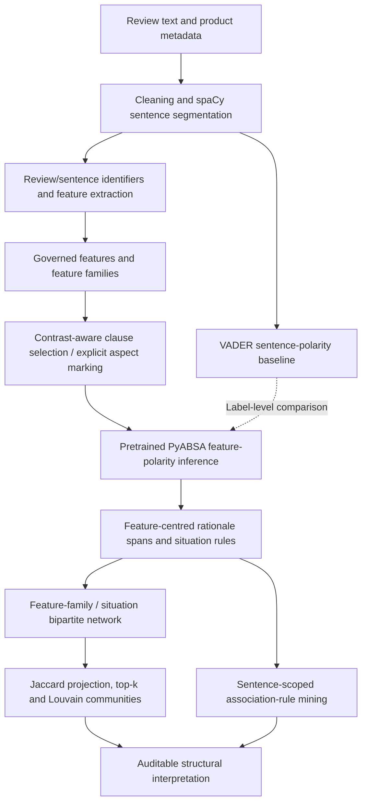
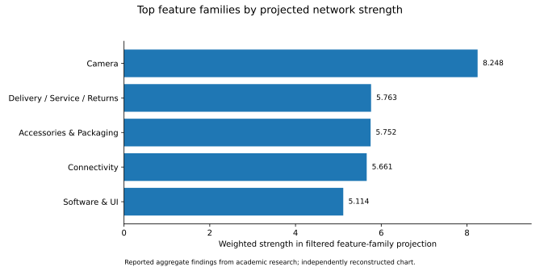

# Beyond Polarity: Explainable Graph-Augmented Sentiment Analysis

**Academic research case study | NLP · Aspect-based sentiment analysis · Interpretable graph analytics**

Customer feedback can contain several opinions about different product features within a single review. A single polarity label obscures the features being evaluated and the circumstances associated with each judgement. **Beyond Polarity** investigated a staged approach to connect aspect-level sentiment to explicit customer-situation labels, relational networks and directional association rules.

The original MSc research integrates **spaCy-based NLP and governed feature extraction**, a **VADER sentence-level baseline**, **pretrained PyABSA aspect-polarity classification**, **contextual situation attribution**, **weighted bipartite feature–situation networks**, **Jaccard projection**, **Louvain community detection** and **association-rule mining**. The contribution lies in **representation design and interpretability**, not a newly trained neural network or a claim to infer causation.

> **Publication boundary:** The results below are from the completed research. This repository contains independently written explanatory documentation, a newly drawn aggregate figure and a deliberately small **synthetic** graph example. It does not distribute the original research implementation, review corpus, manual corrections, notebooks, pretrained weights or original Git history.

## Research question

**Can deep sentiment analysis be made more explainable by augmenting feature-level sentiment predictions with graph analysis and association-rule mining?**

## Method at a glance



### What the NLP stages contribute

- **Segmentation and lineage:** spaCy plus custom sentence-boundary rules preserve review/sentence identifiers, avoiding accidental mixing of observations.
- **Feature discovery and governance:** NER, product-expression patterns and noun-chunk aspects are normalised, manually corrected and grouped into a governed feature taxonomy; fallback labels handle sentences with no qualifying feature.
- **Aspect-centred sentiment:** contrast-aware clause selection reduces interference from other opinions, while target-feature markers supply the pretrained PyABSA classifier with an explicit aspect. Model outputs include polarity, confidence and class probabilities.
- **Situation attribution:** bounded spans near the feature, dependency information, negation/modality/failure/missingness cues and prioritised rules associate the feature with an interpretable customer situation.
- **Network and rules:** weighted feature-family–situation edges capture frequencies, sentiment composition and cue statistics; Jaccard overlap and Louvain expose shared contextual patterns, while association rules express conditional co-occurrence.

These are **documented stages of the original research**, not features implemented in the small public demonstration. [Read the detailed methodology](docs/methodology.md) for processing grain, inference details, analytical choices and limitations.

## Selected research findings

| Measure | Final academic research run |
|---|---:|
| Source customer reviews | 3,062 |
| Segmented sentences | 11,534 |
| Governed sentence–feature rows | 13,102 |
| Feature taxonomy | 149 features / 16 families |
| Network-ready feature–situation rows | 6,675 |
| Bipartite feature-family–situation graph | 30 nodes / 140 edges |
| Top-*k* projected feature-family graph | 15 nodes / 45 edges |
| Louvain communities | 3 |
| VADER versus ABSA label agreement | 64.3% |

**The 64.3% is label agreement, not model accuracy:** the comparison did not use adjudicated ground truth. Customer-situation labels are rule-based interpretations, not verified causal explanations.



The graph analysis placed **Camera** first by weighted strength (8.248) in the filtered feature-family projection. The pattern reflects shared *attributed situations* rather than direct product-feature similarity. [Findings and interpretation](docs/findings.md) include the key counts, centralities, association rules, cautions and diagnostic lessons.

## Minimal synthetic graph demonstration

This public code illustrates **only a small deterministic graph concept**. From invented feature–situation observations, it builds binary incidence sets and calculates the pairwise Jaccard overlap of situation neighbours. It does **not** run PyABSA, carry out NLP extraction, build the full weighted research network, detect Louvain communities, mine association rules or reproduce dissertation results.

Python **3.11+**, standard library only:

```bash
python3 -m demo.graph_example
python3 -m unittest discover -s tests -v
```

The included five unit tests apply to this synthetic graph example alone. No external downloads, review data, credentials or model weights are required.

## Engineering decisions and technical evidence

| Decision | Reason |
|---|---|
| Track distinct review, sentence and feature-mention grains | Preserve lineage and prevent accidental record conflation |
| Govern candidate features and family mappings | Reduce vocabulary noise and stabilise downstream graph structure |
| Select a feature-bearing clause before ABSA | Reduce leakage from contrasting sentiment elsewhere in the sentence |
| Retain rule cues and situation labels | Make contextual attribution auditable rather than opaque |
| Preserve separate feature-family and situation node roles | Interpret cross-type edges without conflating vocabularies |
| Compare structure with association rules | Provide complementary, directional interpretive checks |
| Retain unclassified cases | Avoid manufacturing causal certainty where cues are insufficient |

## Reproducibility and limits

The original source dataset, research implementation, corrections and model assets remain private. The numerical tables are **reported aggregate results** from the research, whereas the public example is a **new illustrative program**. It cannot independently regenerate or verify the academic analysis. See [Methodology](docs/methodology.md) and [Research findings](docs/findings.md).

## Copyright and rights

**Copyright © 2026 David Brown. All rights reserved.** No open-source licence is granted for the original content of this public repository. Referenced external tools and methods retain their own licensing and attribution obligations. See [NOTICE](NOTICE.md).
